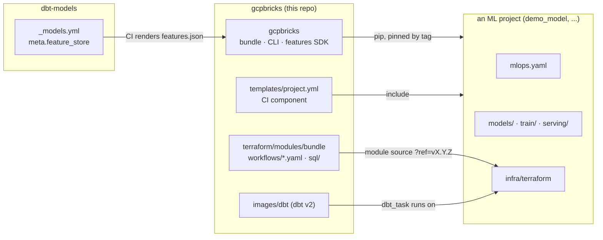
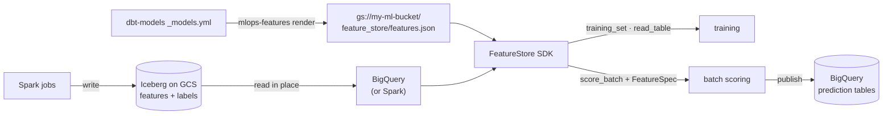
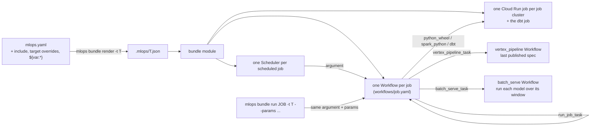

# Architecture

How an ML project goes from code to scheduled training, batch predictions and features on
GCP, and which repo owns which part. [Reference](reference.md) covers the job kinds and the
SDK in detail; this page is the map. Why it is built this way: [Idea](idea.md).

## Principles

- **Declare, don't wire.** A project says what it runs in `mlops.yaml`, in a Databricks
  Asset Bundle's own keys (jobs, tasks, `depends_on`, job clusters, targets, schedules);
  this repo turns that into Workflows, Cloud Run jobs, Cloud Scheduler entries and published
  pipelines. A project writes no orchestration.
- **Databricks' interface, exactly.** A key keeps Databricks' name and meaning; one the
  platform can't run fails validation instead of being ignored. Extensions are few and
  named: `bundle.mlops_version`, `gcp`, `vertex_pipeline_task`, `batch_serve_task`.
- **Deploy code, not models.** A merge builds images and publishes pipeline specs. Training
  happens only when a scheduled (or `mlops bundle run`) execution runs the last published spec.
- **One run definition.** `bundle.job_argument()` is the only place a run's argument is
  built. The scheduler and `mlops bundle run` send the same thing, so an ad hoc run is a
  scheduled run with parameters.
- **Targets are namespaces.** `prod` sits at the root, every other target under its own
  name: storage under `<target>/`, resource names with `-<target>`. A dev run can't touch
  prod objects.
- **dbt is dbt.** A dbt project builds tables and declares which ones are feature groups, and its
  bundle holds the `dbt_task` jobs that build them, on the platform's dbt image. The
  projects that read those tables chain them (`run_job_task` + `lookup`) or follow them
  (`trigger.table_update`).
- **Existing tools first.** Workflows + Cloud Scheduler for orchestration, Cloud Run jobs
  for compute, Vertex AI for pipelines and the model registry, Feast for point-in-time
  joins, BigQuery, Spark and Iceberg for tables.
- **Into this repo only what two projects use.** Model logic, gates and features stay in
  each project.

## Repos

| Repo | Owns |
|---|---|
| gcpbricks | `mlops.yaml` schema (Databricks Asset Bundles' keys), the `mlops bundle` CLI, the Workflow templates and their terraform module, the dbt image, the feature store SDK, the CI component. Released as one tag `vX.Y.Z`: package (GitLab PyPI, project PROJECT_ID), module, component and dbt image together. |
| dbt-models | The feature and label tables (dbt models), and which of them are feature groups: `meta.feature_store` plus column meta in `_models.yml`. Its CI publishes the rendered groups. |
| Each ML project | Its models, training and gates, its image, its scoring job (`serving/serve.py` in demo_model), its `mlops.yaml`, and the terraform root that calls the module with its rendered plan. |

## Data

- Tables are written once and read where they are: no copy or load step between the
  warehouse and the feature store.
- A **feature group** is a table plus metadata: entity keys (`meta.entity`), the as-of
  column (`meta.feature_timestamp`), types, and families (column globs). A date in the
  grain (`install_date`) is a key, so an as-of match never borrows another day's row.
- **Labels are feature groups too**: a label table is created and loaded by its query like
  any other; a training set joins it like features. There is no label store.
- The SDK builds Feast objects from `features.json` into a throwaway local registry on
  every start, so there is no registry to deploy or keep in sync. `read_table` is a window
  read; `training_set` is Feast's point-in-time join.
- A model saves the `FeatureSpec` it trained on next to itself; scoring looks up exactly
  those features, and one dbt-models has since dropped fails loudly.

## Jobs

A job's Workflow runs its tasks level by level (every task's dependencies in earlier levels),
each level in parallel. A task runs when its `run_if` holds over its dependencies, retries
`max_retries` times, and ends `SUCCESS`, `FAILED`, `UPSTREAM_FAILED` or `EXCLUDED`;
`condition_task`, `for_each_task` and `{{...}}` values resolve inside the Workflow, with no
compute of their own. The job fails if any task failed. Every task and run logs one
`mlops_task` / `mlops_run` entry.

| Task type | Compute |
|---|---|
| `python_wheel_task`, `spark_python_task` | the job cluster's Cloud Run job, the project's image |
| `dbt_task` | the platform's dbt Cloud Run job, over the files the last deploy uploaded |
| `vertex_pipeline_task` | Vertex AI, through the `vertex_pipeline` runner Workflow |
| `batch_serve_task` | each model's Cloud Run job (or a Vertex AI batch prediction), through the `batch_serve` runner Workflow |
| `condition_task`, `for_each_task`, `run_job_task` | the Workflow |

A `table_update` or `file_arrival` trigger is checked every 5 minutes by the bundle's
trigger Workflow, and a `file_arrival` one also at once through Eventarc (GCS object
events start the job's wake Workflow); checks share a GCS generation lock on the trigger's
state. Table triggers only poll: Eventarc sees BigQuery jobs through audit logs, not
streaming writes or Spark-written Iceberg; a `RUN_DURATION_SECONDS` health rule starts a watchdog beside each run.
Notifications are log-based Cloud Monitoring alerts on the runs' `mlops_run` and
`mlops_task` log entries. A job's definition lives in GCS and its Workflow reads it when a
run starts, so a run's argument stays a pointer under Workflows' 32 KB limit.

## ML resources

`experiments`, `registered_models` and `model_serving_endpoints` are applied by
`mlops bundle deploy` through the Vertex SDK, not by terraform: a Vertex AI Experiment, a
Vertex Model Registry model (description, declared aliases) and a Vertex AI Endpoint (one
deployed model per served entity, traffic per route). Names carry the target as demo_model
already names them. Deploy creates and updates, never deletes: what the bundle stops
declaring is retired (labelled, an endpoint undeployed), and a console admin deletes it.

Across repos, each repo is a bundle. The project that owns an outcome schedules its
chain: a job that runs the producer's job with `run_job_task` through a `lookup`
variable, then its own tasks, so it starts only after the producer's whole run succeeded
(dbt microbatch included). The producer's jobs carry no schedule and know no consumer. A
consumer that tolerates a partly rebuilt table can follow it with `trigger.table_update`
instead.

A job declared only under one target's `resources` exists only there, so one job can go live
before another: demo_model can train on prod and serve on dev from the same bundle.

## A change, end to end

1. **MR.** CI validates `mlops.yaml` and renders the plan for each target, runs the
   project's tests, and plans terraform. demo_model also builds images and runs the
   full pipeline on `dev` with advisory gates.
2. **Merge.** CI applies terraform (Workflows, Cloud Run jobs with the new image,
   schedulers) and `mlops bundle deploy` uploads the bundle's files and
   publishes each pipeline spec under its target. Nothing trains or scores yet.
3. **Schedule.** Cloud Scheduler starts the job's Workflow with its argument; the run
   uses whatever was last deployed.
4. **Ad hoc.** `mlops bundle run <job> -t <target> --params k=v` starts the same Workflow
   with the same argument and those job parameters: for `batch_serve_task`, a backfill
   window or a model subset.
5. **Look back.** `mlops bundle runs <job> -t <target>` lists executions; a failed
   `batch_serve_task` run's error names the models that failed; a failed execution alerts the
   notification channels the project passes the module.

## Contracts held by tests

| Between | Test |
|---|---|
| `job_argument()` and `job.yaml`, each task descriptor and its branch, each runner Workflow and its task: every key sent is read, every key read is sent; every `run_if`, `condition_task` op and `{{...}}` value is handled | `tests/test_workflows.py` |
| `batch_serve` Workflow and what `batch_serve.window()` reads; `write_window`'s checks before its delete, `write`'s append / insert_new / merge scripts; a repair resuming failed models and skipping chunks `chunk_done` noted | `tests/test_batch_serve.py`, `tests/test_batch_serve_job.py`, `tests/test_publish_and_cli.py` |
| the bundle loader against Databricks' semantics: includes, target merges by key, variables, Quartz → cron, unsupported keys refused | `tests/test_bundle.py` |
| a `dbt_task`'s runner and the files a deploy uploads; the wheel launcher | `tests/test_task_runner.py`, `tests/test_publish_and_cli.py` |
| `trigger.yaml` and `watchdog.yaml` against what the bundle sends them; every alert against a state the Workflows log | `tests/test_workflows.py` |
| ML resources: names per target, the size table, and deploy against a fake Vertex (create, redeploy before undeploy, aliases, orphans) | `tests/test_ml.py` |
| dbt-models' declarations and the SDK | `tests/test_features.py`, and dbt-models' `feature-config-check` CI job |
| Workflows' own limits: unique step names, expressions under 400 characters | `tests/test_workflows.py`, `tests/test_batch_serve.py` |
