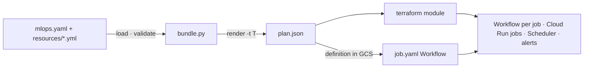

# Idea

## The problem

On Databricks, a data or ML project describes its jobs in a `databricks.yml` and the CLI
deploys and runs them: tasks, dependencies, retries, schedules, parameters, `dev` and `prod`
targets, repairs of a failed run. On GCP, the same work is usually wired by hand, per project:

- a Cloud Workflows YAML to order the steps and retry them,
- a Cloud Run job per step, a Cloud Scheduler entry per cron,
- Terraform to keep all of it in sync, and a separate way to rerun after a failure,
- no shared notion of "a run", so no way to see one in one place or repair part of it.

Each project reinvents this, and each version is a little different. The platform in this
repo does it once.

## The idea

**Keep Databricks' interface, run it on GCP's own services.**

A project writes a bundle in Databricks' keys. A loader validates it, resolves variables and
targets, and `render()` produces a plan, one JSON document. A Terraform module turns the plan
into Workflows, Cloud Run jobs and Scheduler entries; a Workflow template runs any job from
its definition stored in GCS. Nothing runs between runs: no cluster, no always-on scheduler
service, nothing to patch.

## Design decisions

- **Same keys, same meaning, or refuse.** A key keeps Databricks' name and semantics. A key
  the platform can't run fails validation. A silent no-op is worse than an error, because a
  project would believe a retry or a trigger exists when it doesn't. The few extensions are
  named: `bundle.mlops_version`, `gcp`, `vertex_pipeline_task`, `batch_serve_task`.
- **One definition of a run.** `job_argument()` is the only place a run's argument is built.
  The scheduler and `mlops bundle run` send the same thing, so an ad hoc run is a scheduled
  run with parameters, and a repair is a run with `repair_of` set.
- **The job's definition lives in GCS, not in the Workflow.** A Workflow reads it when a run
  starts. Workflows' argument limit is 32 KB; a pointer always fits, a definition may not.
- **Deploy code, not models.** A merge publishes images and pipeline specs. Training happens
  when a schedule (or a person) runs the last published spec, never as a side effect of a
  merge.
- **Targets are namespaces.** `prod` sits at the root; every other target lives under its own
  name (storage prefix, `-<target>` on resource names). A dev run cannot touch prod objects
  by construction.
- **Compose existing services.** Workflows, Scheduler, Cloud Run, Vertex AI, BigQuery, dbt,
  Feast's point-in-time join, Iceberg. The platform is the glue and the interface, not a
  new engine.
- **Tables are written once, read in place.** The feature store has no copy step and no
  registry to deploy: it builds throwaway Feast objects from a JSON of feature groups on every
  start.
- **Contracts are tested.** The loader, the Workflow templates and the CLI agree on what a
  run carries. A test checks that every key sent is read and every key read is sent, so a
  rename on one side fails in CI instead of in a night run.

## What it deliberately is not

- Not a Databricks clone. There is no notebook cluster, no Unity Catalog, no Delta; the
  compatible part is the bundle format and job semantics.
- Not a general orchestrator like Airflow. It runs a job's tasks level by level; it has no
  sensors, pools or backfill UI.
- Not model logic. Training code, gates and features stay in each project; only what two
  projects need comes into the platform.

## Trade-offs

| Choice | Gain | Cost |
|---|---|---|
| Workflows + Cloud Run instead of a cluster | Nothing idle, no cluster to operate, per-task isolation | Cold start per task; no shared in-memory state between tasks |
| Definition in GCS | No 32 KB limit, definitions can be redeployed without touching Workflows | A run depends on a GCS object read at start |
| Refuse unknown keys | No silent behaviour gaps | Can't adopt a Databricks bundle unchanged if it uses an unsupported key |
| Terraform applied by the CLI | A project carries no Terraform | The CLI needs terraform and the right roles on the deploying account |
| Repairs from run logs | Works for cancelled runs, which return no task results | Depends on the structured logs the Workflows write |
